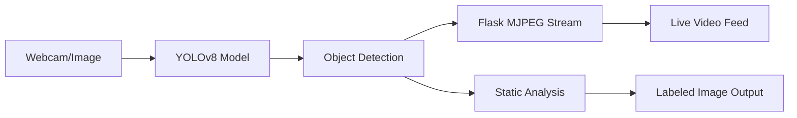

# 🎯 Real-Time Object Detection with YOLOv8

<div align="center">


**Real-Time Object Detection Web Application**

[]()
[](https://github.com/samalarakshithbabu/yolov8-object-detection/issues)

</div>

---

## 🚀 Executive Summary

A **real-time object detection web application** using YOLOv8 deep learning models integrated with Flask. Captures live webcam footage or processes static images to detect and label objects with high accuracy. Ideal for surveillance, automation, and smart monitoring applications.

### What It Does



---

## ✨ Key Features

| Feature | Description |
|---------|-------------|
| **Real-Time Webcam Detection** | Live video streaming with YOLOv8n at ~16 FPS |
| **Image-Based Detection** | High-accuracy analysis using YOLOv8m |
| **Flask Web Interface** | Browser-based live feed viewer |
| **Confidence Thresholding** | 0.5 minimum confidence filter |
| **Multi-Model Support** | Nano (fast) to Medium (accurate) models |

---

## 🛠️ Technology Stack

| Component | Technology | Purpose |
|-----------|------------|---------|
| **Backend** | Python + Flask | Web server & API |
| **Object Detection** | Ultralytics YOLOv8 | Deep learning models |
| **Computer Vision** | OpenCV | Image/video processing |
| **Visualization** | Matplotlib | Result plotting |

---

## 📁 Project Structure

```
yolov8-object-detection/
├── app.py              # Flask web app for live webcam detection
├── model.py            # Script for image-based object detection
├── templates/
│   └── index.html      # Web UI for live feed
├── static/             # Sample images
├── runs/               # Detection outputs
├── requirements.txt    # Python dependencies
└── README.md           # This file
```

---

## 🛠️ Installation

### Prerequisites
- Python 3.8+
- pip
- Webcam (for live detection)

### Setup
```bash
git clone https://github.com/samalarakshithbabu/yolov8-object-detection.git
cd yolov8-object-detection
pip install -r requirements.txt
```

---

## 🚀 Running the Application

### Real-Time Webcam Detection
```bash
python app.py
```
- Application: `http://localhost:5000`
- Features live MJPEG streaming with detection overlays

### Image-Based Detection
```bash
python model.py
```
- Processes static images and saves labeled outputs

---

## 📊 Detection Models

| Model | Speed | Accuracy | Use Case |
|-------|-------|----------|----------|
| **YOLOv8n** | Fastest | Good | Real-time webcam |
| **YOLOv8m** | Medium | Better | Static images |

---

## ⚠️ Limitations

| Limitation | Description |
|------------|-------------|
| **Hardware** | Requires webcam for live detection |
| **Model Files** | yolov8n.pt, yolov8m.pt must be downloaded |
| **Error Handling** | No handling for missing camera/model files |

---

## 📄 License

This project is licensed under the MIT License.

---

## 👨‍💻 Author

**SAMALA RAKSHITH BABU**

- 📧 Email: samalarakshithbabu7@gmail.com
- 💼 LinkedIn: [samala-rakshith-babu](https://www.linkedin.com/in/samala-rakshith-babu/)
- 🐙 GitHub: [samalarakshithbabu](https://github.com/samalarakshithbabu)

---

<div align="center">

**Built with ❤️ for Computer Vision Applications**

</div>